# llm-platform-console

> Исходный код проекта закрыт — здесь его описание: архитектура, решения и результаты. Код покажу по запросу: Telegram [@interpol2121](https://t.me/interpol2121).

Консоль LLM-платформы и её «зонт»: этот репозиторий делает работу четырёх
бэкендов **видимой** — исследовательский чат с живой трассой агента, каталог
моделей с проверкой доступности, расход и стоимость, локальная база знаний —
и он же поднимает всю платформу одной командой.

Платформа — пять репозиториев: шлюз к моделям
[llm-gateway](https://github.com/INTERpol21/llm-gateway), поиск по базе знаний
[rag-pgvector](https://github.com/INTERpol21/rag-pgvector), исследовательский агент
[agent-orchestrator](https://github.com/INTERpol21/agent-orchestrator), MCP-инструменты
[mcp-tools-server](https://github.com/INTERpol21/mcp-tools-server) и эта консоль.

## Платформа целиком

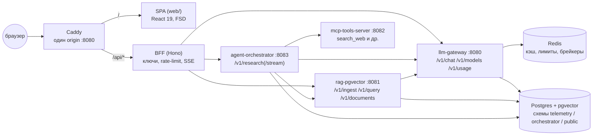

У бэкендов **нет CORS** и нет ключей, пригодных для браузера. Браузер говорит
с одним origin (Caddy); BFF подставляет платформенные bearer-ключи и
проксирует запросы, пропуская SSE насквозь — трасса агента стримится живьём.

| Репозиторий | Роль |
|---|---|
| [llm-gateway](https://github.com/INTERpol21/llm-gateway) | OpenAI-совместимый шлюз: маршрутизация и фолбэки, точный и семантический кэш, Redis-брейкеры, журнал стоимости |
| [rag-pgvector](https://github.com/INTERpol21/rag-pgvector) | Поиск по знаниям: гибридный ретривал (вектор + BM25/FTS через RRF), папка-коннектор, цитаты |
| [agent-orchestrator](https://github.com/INTERpol21/agent-orchestrator) | Исследовательский агент на LangGraph: plan → parallel execute → reflect → synthesize |
| [mcp-tools-server](https://github.com/INTERpol21/mcp-tools-server) | MCP-инструменты: офлайн-поиск, read-only SQL, файлы в песочнице; bearer на HTTP |
| **llm-platform-console** | Этот репозиторий: SPA + BFF + Caddy + зонтичный compose |

## Сборка и запуск — главный план

Четыре бэкенд-репозитория должны лежать рядом с этим
(`../llm-gateway`, `../rag-pgvector`, `../mcp-tools-server`,
`../agent-orchestrator`).

```bash
cp .env.example .env
docker compose up --build          # консоль на http://localhost:8080
docker compose --profile full up   # плюс Ollama для настоящих локальных моделей
```

Что происходит при старте:

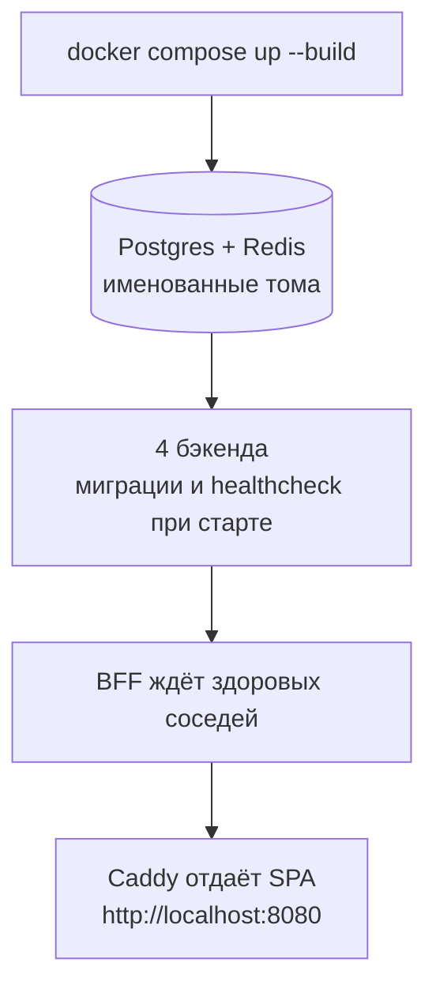

- Постоянное состояние (Postgres, Redis) живёт в именованных томах и
  переживает `docker compose down`.
- Всё работает офлайн на мок-моделях — ни одного API-ключа не нужно.
  Настоящие провайдеры остаются в статусе `not_configured`, пока в `.env`
  не появятся ключи (`OPENAI_/ANTHROPIC_/DEEPSEEK_/MOONSHOT_/DASHSCOPE_API_KEY`).
- Веб-поиск (`search_web` в mcp-tools-server) по умолчанию отвечает из
  небольшого офлайн-индекса. Живой поиск включается в `.env`:
  `WEB_SEARCH_PROVIDER=tavily` и `WEB_SEARCH_API_KEY` (все пять
  `WEB_SEARCH_*` описаны в `.env.example`). Провайдер получает каждый
  поисковый запрос; пока в Настройках включено скрытие персональных данных,
  оркестратор держит поиск на офлайн-индексе.
- Демо-корпус сеется командой `make demo-seed`; `make demo-reset` очищает
  таблицы rag, сбрасывает Redis и сеет корпус заново.

### Настоящие локальные модели (Ollama)

Маршруты `llama3.2` и `qwen2.5` шлюза идут в Ollama; пока демон недоступен,
они отвечают через фолбэк `mock-small` (Сравнение и Телеметрия так и пишут:
«Резервный маршрут», `qwen2.5 → mock-small`). Два способа дать им демон:

- **Ollama на хосте — лучший вариант на Mac.** Docker Desktop на macOS не
  отдаёт контейнерам GPU, поэтому сервис `ollama` из `--profile full`
  считает на CPU, а нативный Ollama — на Metal. Скачай модели на хосте
  (`ollama pull qwen2.5`, `ollama pull llama3.2`), запусти стек без
  `--profile full` и пропиши в `.env`:

  ```bash
  OLLAMA_BASE_URL=http://host.docker.internal:11434
  ORCHESTRATOR_MODEL=qwen2.5   # необязательно: Исследование на локальной модели
  JUDGE_MODEL=llama3.2         # необязательно: судья Tier 2 — другая модель
  ```

  После правки `.env` — `docker compose up -d`: compose пересоздаст шлюз и
  оркестратор с новыми переменными.
- **Ollama в compose** — `docker compose --profile full up`, затем один раз
  `docker compose exec ollama ollama pull llama3.2` (на CPU, медленно).

`ORCHESTRATOR_MODEL` по умолчанию `mock-small`: стек офлайн и бесплатный.
Режим «Агент» (вызов инструментов) на маршруте Ollama требует
llm-gateway **≥ 1.40.0** — раньше запрос с `tools` к `llama3.2`/`qwen2.5`
получал 400. Пустой `JUDGE_MODEL` означает саму `ORCHESTRATOR_MODEL`: модель
оценивает собственные ответы.

## Что посмотреть (экскурсия на две минуты)

1. **База знаний** — задай вопрос по-русски или по-английски:
   «как объединяются результаты векторного и ключевого поиска» — ответ
   придёт со сносками `[n]` на найденные фрагменты. Вкладка
   **«Лаборатория поиска»** (`/knowledge?tab=lab`) показывает, почему
   фрагмент встал на своё место: один вопрос при рабочих настройках и при
   варианте рядом (режим, правило слияния, веса, вес «сначала своё»,
   переранжирование) — одним запросом над одним пулом кандидатов, с вкладом
   каждой ноги поиска в оценку и сдвигом мест. Щелчок по заголовку открывает
   сам документ: его фрагменты по порядку, с отметкой найденного. Рабочие
   настройки лаборатория не меняет. Карточка **«Коллекции»** заводит
   отдельный корпус («Документация продукта» → идентификатор
   `dokumentatsiya-produkta`) и делает его рабочим: добавление, загрузка,
   поиск и список документов дальше работают с ним. Непустую коллекцию и
   коллекцию по умолчанию удалить нельзя — причина написана рядом с кнопкой.
2. **Исследование** — дай агенту вопрос: «что такое RRF и зачем он нужен».
   Живая SSE-трасса покажет план → параллельное выполнение → рефлексию →
   синтез, с уликами из базы знаний и веб-поиска через MCP. Переключи
   «Стратегию» на «Агент» — сначала придут фрагменты базы знаний, потом
   карточка «Инструмент · из офлайн-индекса»: каждая веб-ссылка говорит,
   откуда она — из живого поиска («через Tavily»), из офлайн-индекса, или из
   индекса вместо недоступного живого поиска (тогда запуск помечен
   «Деградация»). Задай уточнение —
   и ссылка «Весь диалог» у чипа сессии откроет постоянную страницу
   `/research/threads/<id>`: все ходы по порядку, с источниками, трассой,
   оценкой и честными пометками «Прерван» / «Сбой сервера» / «Деградация», плюс
   выгрузка всего диалога в Markdown или JSON. Недавний вопрос, открытый
   заново, восстанавливает последние ходы ленты, а не один снимок.
   Переключатель **«Источники: только локальные»** запрещает запуску веб-поиск
   на обеих стратегиях; ответ, который сервер так и выполнил, получает
   значок «Без веб-поиска». Выбор переживает переход на другие страницы.
3. **Дорожная карта** — план всей платформы, отрендеренный из
   `docs/ROADMAP.md`: история релизов по эпохам и активный фронт.
4. **Пульт** — здоровье всех сервисов и схема архитектуры.
   **Статус** рядом — история доступности каждого сервиса за сутки, сбои как
   инциденты и оповещения Prometheus: `docker compose stop rag` — и через
   полминуты на странице появится продолжающийся инцидент, а после
   `docker compose start rag` он закроется со своей длительностью. Там же
   карточка **«Резервные копии»**: свежа ли копия единственной базы платформы
   и восстанавливали ли её хоть раз — со ссылкой на отчёт проверочного
   восстановления.
5. **Модели / Расход / Телеметрия** — каталог с пингом доступности; расход
   по моделям и по функциям платформы (карточка «По функциям платформы»:
   какая часть платформы потратила деньги — по метке `X-Attribution`, которую
   каждый сервис ставит на свои вызовы шлюза); одна строка на каждый вызов
   модели — с функцией, которая его сделала, и тем, откуда взялись его токены.
   Телеметрия — ещё и инспектор: вставь `X-Request-ID` из ответа любого
   сервиса — обе вкладки покажут только вызовы моделей и запуск исследования
   этого запроса; у каждой вкладки свои фильтры (модель, статус, кэш,
   функция; режим, деградация, прерывание, сессия) и общий период. Вкладка,
   фильтры и выбранный запуск живут в адресе: кнопка «Скопировать ссылку»
   даёт адрес, который в новой вкладке откроет ровно тот же вид — даже если
   запуска нет на первой странице списка.
6. **Настройки → «Персональные данные в запросах к моделям»** — видно,
   включено ли вырезание ПДн, каким движком и сколько сущностей убрано за
   неделю с разбивкой по типам. Тумблер меняет поведение шлюза со следующего
   же запроса. Если движок `regex`, панель отдельно предупредит, что ФИО не
   покрыты: «защита включена» и «имена защищены» — разные вещи.
7. **Полигон отказоустойчивости** — взведи ручки отказов mock-провайдера
   (доля отказов, задержка, retry-after) и запусти пачку проб: видно, как
   ретраи и фолбэки поглощают сбои. Терминальный failure-drill, но в браузере.
8. **Качество → тренд** — покрытие цитат по прогонам во времени: просадка
   качества — это падающая линия, а не число для ручного сравнения. Вкладка
   **«План или агент»** сравнивает две стратегии (задай пару вопросов на
   «Исследовании» со стратегией «Агент»): стоимость, задержку, Tier 1, Tier 2
   и голоса — с числом завершённых запусков в каждом столбце и предупреждением,
   пока их мало; сравнение наблюдательное, стратегию выбирают под вопрос.
   **«Судья и люди»** кладёт 👍/👎 из Телеметрии против вердикта LLM-судьи в
   матрицу 2×2 — совпадение и κ Коэна появятся только от 20 пар. На «Обзоре»
   кнопка **«Дооценка Tier 2»** оценивает прошлые запуски пачками, которые
   сервер успевает за один раунд; на офлайн-стенде mock-судья честно отвечает
   «сбой», и такие оценки остаются в очереди на следующий проход.
9. **Дорожная карта → CI** — состояние сборок и открытые PR всех пяти
   репозиториев на одной панели.
10. Брось любой `.md`/`.pdf`/`.docx` в `./dropbox` — папка-коннектор
   заберёт файл в течение ~5 секунд, и он станет находимым в Базе знаний.
   Та же папка (только на чтение) — корпус офлайн-mock шлюза: без ключей он
   отвечает цитатами из твоих заметок, а не эхом вопроса; шлюз читает её при
   старте, так что новый файл дойдёт до mock после перезапуска gateway.
11. **С клавиатуры** — ⌘K / Ctrl+K (или `/`) открывает командную палитру:
   раздел, недавний вопрос (открывает страницу его диалога) или действие по
   нескольким буквам; `g` и буква ведут в раздел (`g m` — Модели), `?`
   показывает все сочетания.
12. **Инструменты агента** — что публикует mcp-tools-server, какие из этих
   инструментов оркестратор на самом деле вызывает (шаг плана `web_search`,
   локальный `rag_search`, разрешённые агенту) и совпадают ли схемы
   аргументов: зелёный вердикт значит, что ни один сегодняшний вызов не
   теряет аргумент молча. Останови `mcp` (`docker compose stop mcp`) —
   страница назовёт причину и сама вернётся к «Отвечает», когда сервер
   поднимется.
13. **Лаборатория чата** (`/chat`, `g h`) — обычный чат с одной моделью, и у
   каждого ответа две панели: «Что сделал шлюз» (какая модель ответила и был
   ли резервный маршрут, сколько попыток не удалось, точное или смысловое
   попадание в кэш, отброшенные параметры, вырезанные ПДн, стоимость и время
   до первого токена) и «Строка журнала» — запись `model_runs`, найденная по
   `X-Request-ID` вызова. Отправь вопрос, нажми «Повторить» — точное
   попадание; начни новый чат и задай тот же вопрос с «?» на конце —
   смысловое попадание со сходством ~0.97. Уточняющие вопросы внутри чата —
   всегда промахи: смысловой кэш отвечает, только когда всё до последнего
   сообщения совпадает дословно и вызывающий прислал `X-Semantic-Cache:
   allow` (ADR-0015, решение 6). Параметр `{"seed": 1}` в «Дополнительных
   параметрах» шлюз откажет с кодом 400 и назовёт его.
14. **Бюджеты расходов** — в Настройках задай предел в USD на сутки или месяц
   (UTC) для всего трафика, одного ключа, одной модели или одной метки
   `X-Attribution`. На странице «Расход» панель «Бюджеты» покажет, насколько
   каждый заполнен и когда обнулится; при пересечении порога на любой
   странице всплывёт живое оповещение, а исчерпанный обязательный бюджет
   шлюз отклоняет с HTTP 429 `budget_exceeded` — строкой ошибки в телеметрии,
   переведённой ячейкой на «Сравнении».
15. **История изменений настроек** — открой «Настройки» в двух вкладках,
   поменяй долю выборки судьи в первой: вторая покажет новое значение
   примерно через секунду, без перезагрузки. Если во второй была
   несохранённая правка, она останется, а рядом появится «Эту настройку
   изменили в другом сеансе» с кнопкой «Загрузить новые значения». Под каждой
   карточкой — свёрнутая «История изменений»: когда, что было → что стало,
   «Ваш ключ · 2f1c9a0b» или «Другой ключ» и id запроса. То же — у ручек
   отказов на «Полигоне» и у бюджетов расходов.

## Разделы в кадре

Тёмная тема, снято `web/e2e/screenshots.spec.ts` против живого стека
(`pnpm --filter @console/web test:e2e -- screenshots`; регенерировать при
заметном изменении UI).

| | |
|---|---|
| 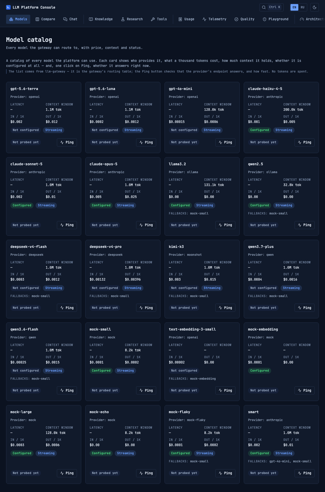 | 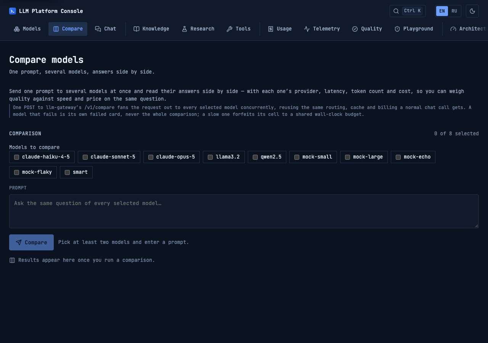 |
| 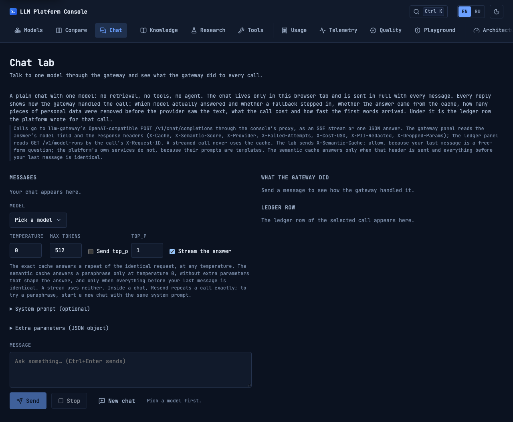 | 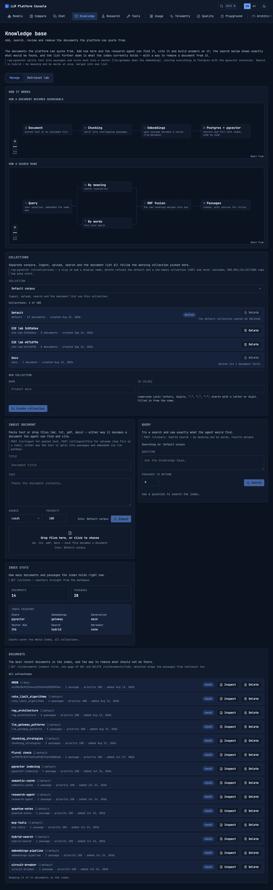 |
| 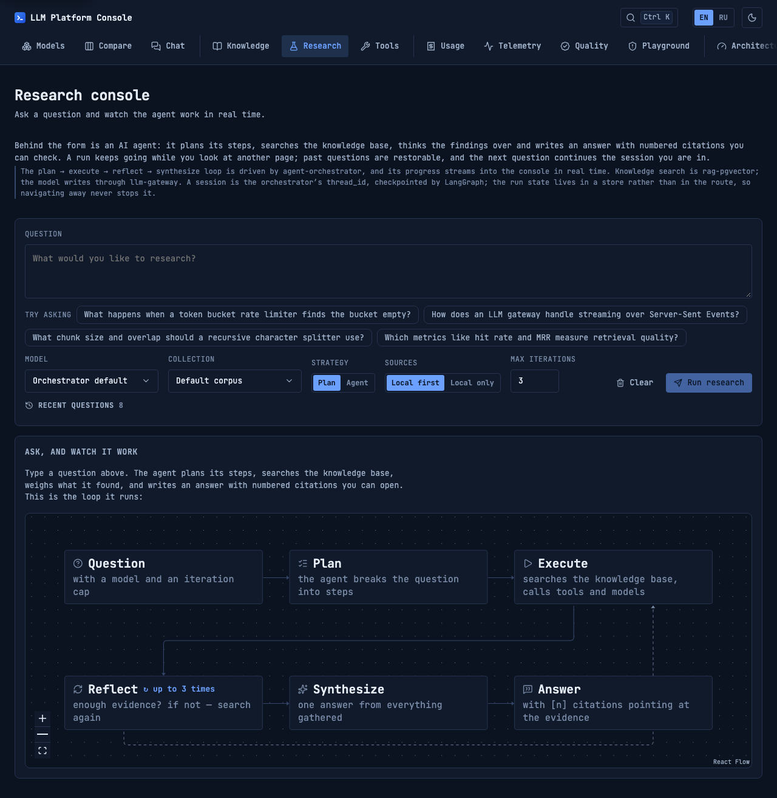 | 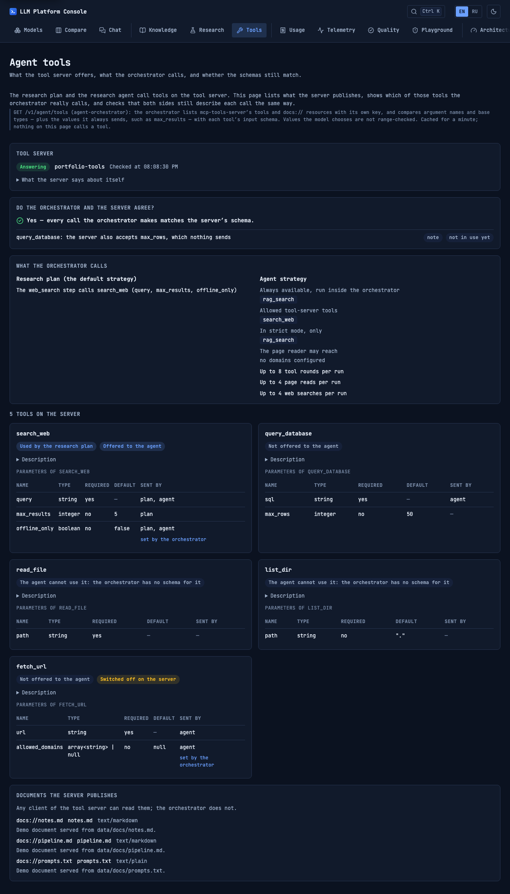 |
| 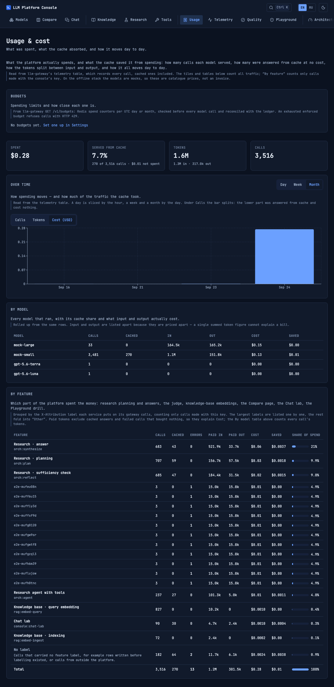 | 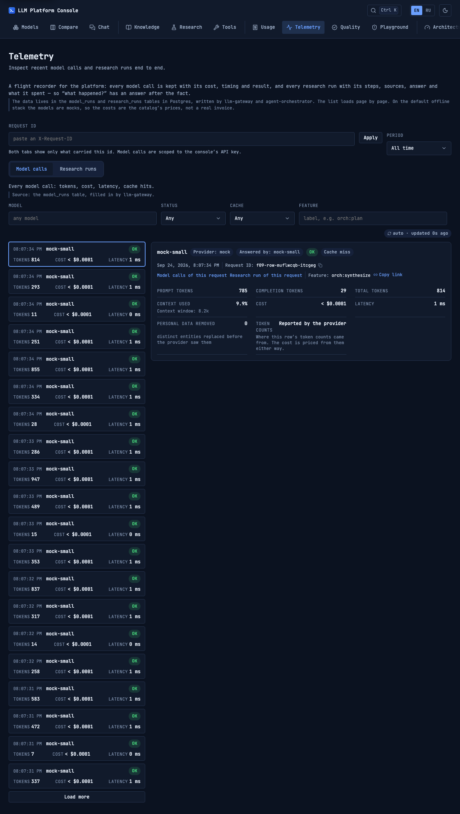 |
| 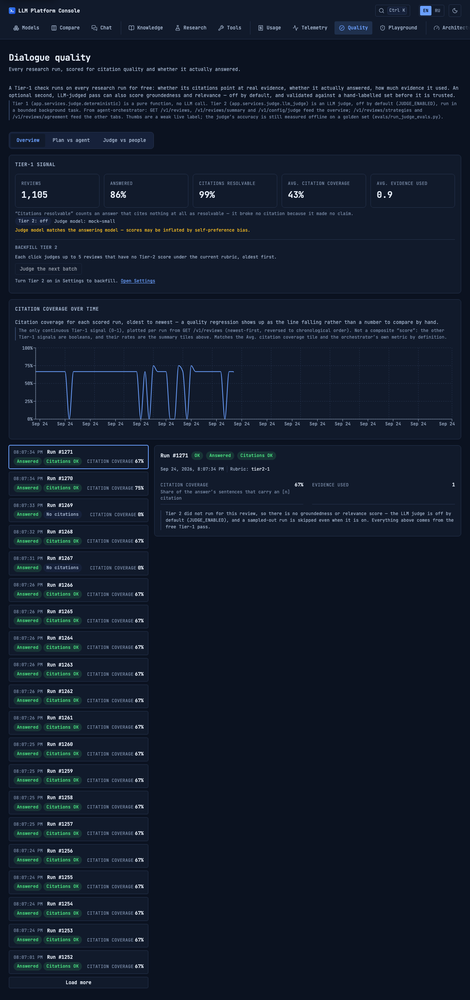 | 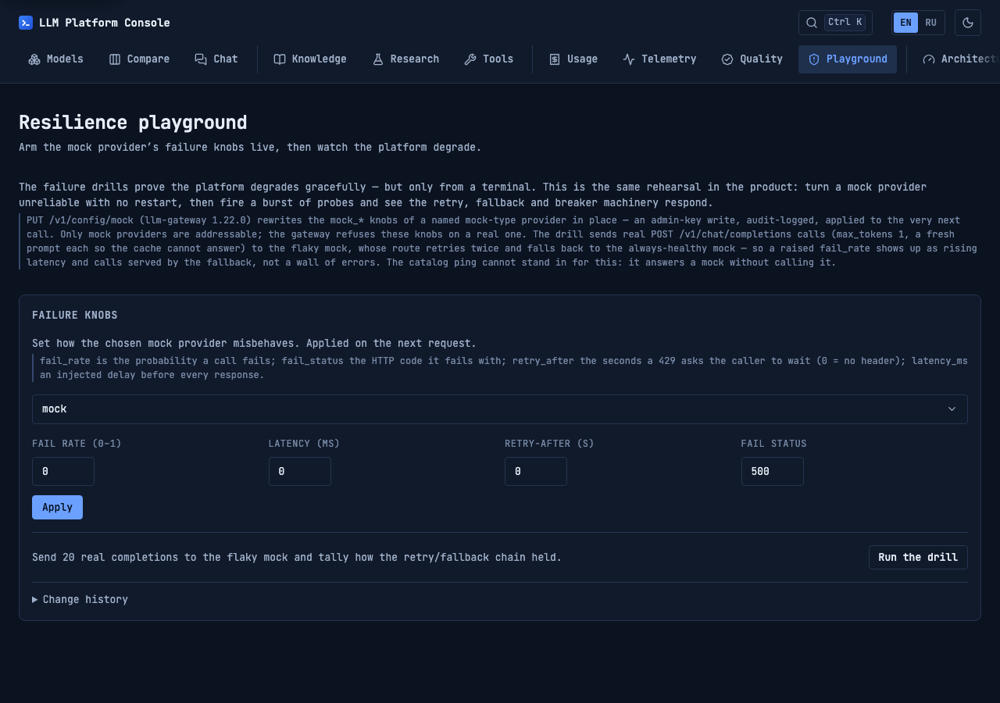 |
| 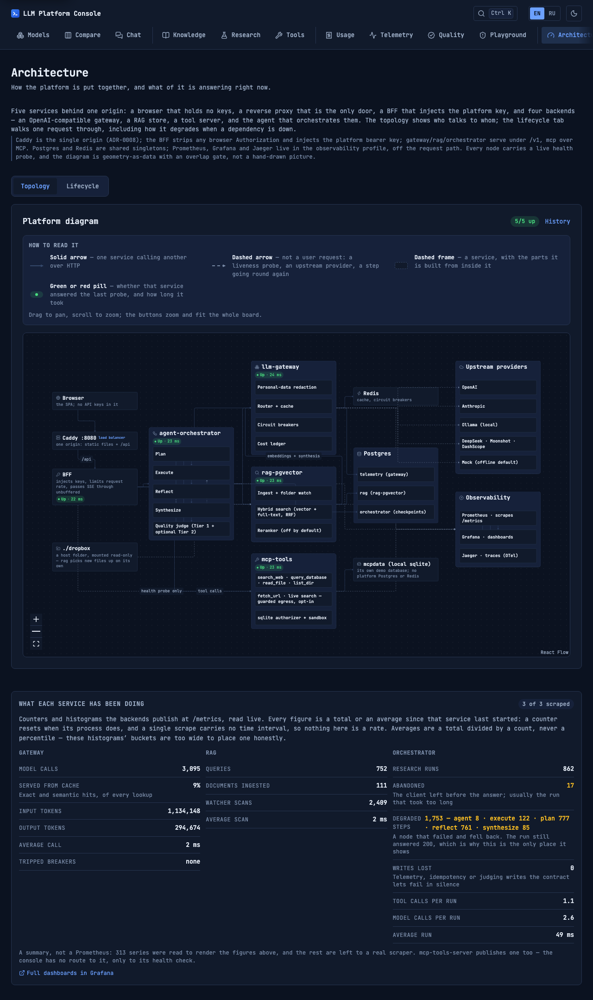 | 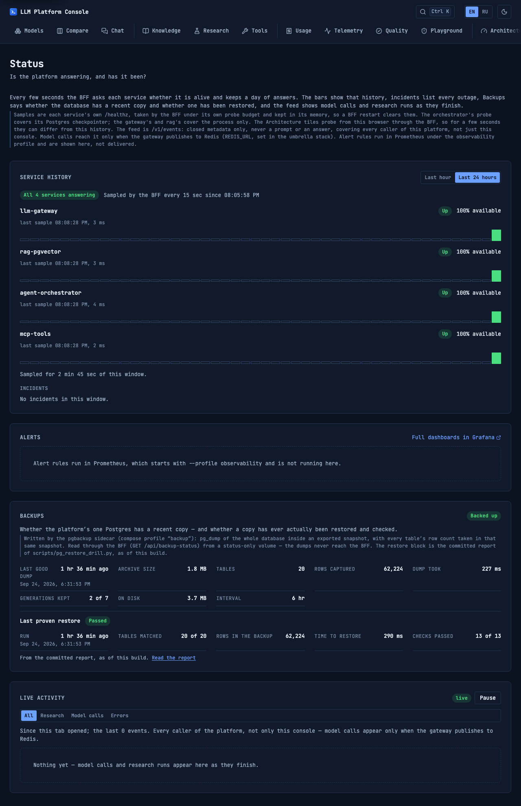 |
| 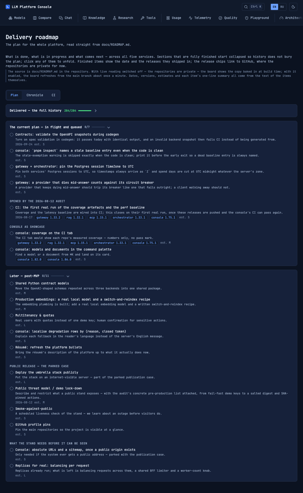 | 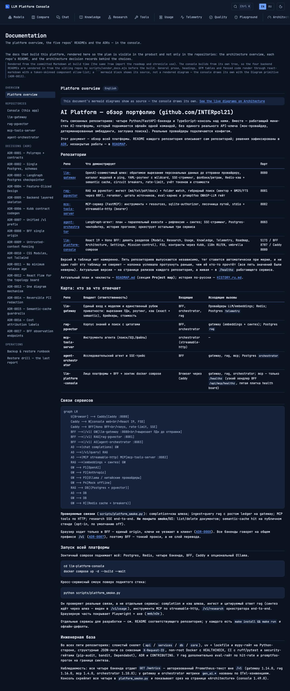 |
| 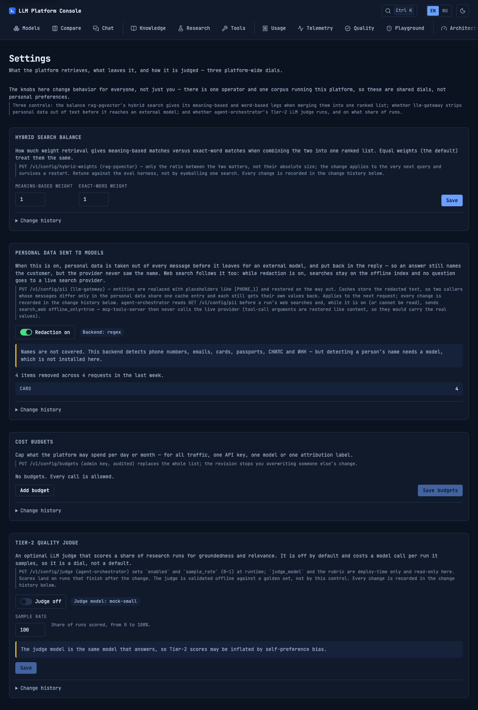 | |

## Наблюдаемость

Все четыре бэкенда публикуют `/metrics` за bearer-ключом; профиль
`observability` добавляет к стеку сборщик и один дашборд:

```bash
docker compose --profile observability up -d   # + Prometheus и Grafana
```

- **Grafana** — http://localhost:3300 (анонимный просмотр, без логина):
  дашборд «LLM Platform» — запросы и ошибки по сервисам, латентности p50/p95/p99
  (шлюз и исследовательские раны), токены из `gen_ai_*`-серий, хиты/промахи
  кэша, деградации оркестратора, вызовы MCP-инструментов и статус всех
  четырёх скрейп-таргетов. Стоимость на дашборде отсутствует сознательно —
  она живёт в телеметрии Postgres и видна в разделе «Расход».
- **Prometheus** — http://localhost:9090 (только loopback): скрейп всех
  четырёх `/metrics` каждые 15 секунд с тем же `PLATFORM_KEY`, что и у
  бэкендов.

Профиль не входит в базовый стек намеренно: демо-платформа остаётся
восьмиконтейнерной, а сборщик присоединяется, когда на него хотят смотреть.

Страница **«Статус»** (`/status`) работает и без профиля: BFF сам опрашивает
`/healthz` всех четырёх сервисов каждые 15 секунд
(`STATUS_SAMPLE_INTERVAL_MS`; у пробы свой бюджет `STATUS_PROBE_TIMEOUT_MS`,
5 секунд, — не 120-секундный таймаут данных) и держит историю за сутки в
памяти: перезапуск BFF её стирает, и страница об этом говорит. Значение вне
диапазона останавливает BFF при старте с именем переменной. Оповещения на
той же странице — правила `infra/prometheus/rules.yml` (ServiceDown,
GatewayErrorRateHigh, BreakerOpen, ResearchDegradationsHigh), которые
Prometheus вычисляет только под профилем `observability`; без него панель так
и говорит, а не показывает «оповещений нет». Alertmanager нет: оповещения
показываются, но никуда не отправляются. `PROMETHEUS_URL=''` выключает панель
совсем; `make prom-rules` прогоняет юнит-тесты правил через promtool из того
же образа, что и Prometheus в compose (офлайн, `--network none`).
Внизу той же страницы — **живая лента**: вызовы моделей и исследования по
мере завершения, из единственной подписки консоли на `/v1/events`. Только
закрытые метаданные (модель, статус, время, стоимость, токены) — ни запросов,
ни ответов, ни идентификаторов; лента общая для всех клиентов платформы, а
вызовы моделей попадают в неё, только когда у шлюза есть Redis (в общем стеке
он есть). Пауза замораживает список, фильтры отделяют ошибки от деградаций.
Туда же попадают **изменения настроек** (F14): какой сервис и какую
настройку поменяли — без значений и без того, кто менял. Каждое изменение
редакции ПДн, ручек отказов, бюджетов, весов гибридного поиска и судьи Tier 2
сервис-владелец сначала записывает в свою таблицу, а уже потом применяет:
нет записи — нет изменения (закрытый 503 `config_audit_unavailable`, в
консоли — «Не применено: журнал изменений недоступен…»). Исключение одно —
включение редакции ПДн при недоступной базе: оно применяется, и карточка
говорит, что изменение записано только в лог шлюза. Факт `config_changed`
на шине — лишь подсказка обновиться; правда — `GET /v1/config/changes`
каждого сервиса. Без Redis (офлайн) факты шлюза и rag до ленты не доходят —
оркестратор доставляет только свои; вкладка, которая сохранила изменение,
всё равно сразу видит свою строку в истории.

Так же, отдельным профилем, подключается хаос-прокси для дриллов шлюза
(`make resilience` в `../llm-gateway`): Toxiproxy встаёт между шлюзом и Redis
или сокетом провайдера и рвёт соединение посреди ответа.

```bash
docker compose --profile resilience up -d toxiproxy   # хаос-прокси для дриллов шлюза (Redis :16379, апстрим :18090); базовый стек должен быть поднят; только последовательно
```

## Резервные копии

Всё, что платформа помнит, — корпус rag с векторами, телеметрия и контрольные
точки исследований — лежит в одном Postgres. Профиль `backup` добавляет
сайдкар `pgbackup` на том же закреплённом образе, что и сама база:

```bash
docker compose --profile backup up -d   # или COMPOSE_PROFILES=backup в .env
make backup-now                         # внеочередная копия (run --rm --no-deps)
python3 scripts/pg_restore_drill.py     # проверочное восстановление в одноразовый контейнер
```

- Раз в 6 часов по настенным часам (`PGBACKUP_INTERVAL_SECONDS`) — `pg_dump`
  внутри экспортированного снимка; число строк каждой таблицы считается в том
  же снимке и попадает в манифест. Хранится `PGBACKUP_KEEP` поколений (7 —
  окно в 42 часа); перезапуск контейнера лишней копии не делает, а неудачная
  попытка никогда не вытесняет удачную.
- **`docker compose down -v` удаляет том с копиями вместе с `pgdata`.** Чтобы
  копии это пережили, укажи `PGBACKUP_TARGET=/абсолютный/путь/на/хосте`.
- В дампах — ответы исследований и контрольные точки: права 0600, BFF их не
  видит (он читает только файл статуса с отдельного тома), выносить с машины —
  только зашифрованными.
- `scripts/pg_restore_drill.py` восстанавливает последнее поколение в
  контейнер без сети и опубликованных портов и сверяет его с манифестом:
  sha256, число строк каждой таблицы, журналы миграций, последовательности,
  размерность векторов и HNSW-запрос. Время восстановления попадает в
  `docs/RESTORE_DRILL.md` и в карточку на странице «Статус».

Подробности — в `docs/BACKUP.md`.

## Не для продакшена

Это демонстрационная платформа-портфолио. `demo-key` — общий, заранее
известный bearer-токен: он показывает **механизм** авторизации
(сравнение за постоянное время, скоупы ключей, подстановка на стороне BFF),
а не реальное разграничение доступа. Управления пользователями и изоляции
арендаторов нет; телеметрия видна каждому держателю ключа. Лимиты размера
тела и частоты запросов включены по умолчанию — не отключай их.

## Разработка

```bash
pnpm install
pnpm contracts        # перегенерировать типы/Zod из packages/contracts/openapi/*.json
pnpm dev:bff          # Hono BFF на :8787
pnpm dev:web          # Vite dev-сервер на :5173 (проксирует /api → :8787)
pnpm -r typecheck && pnpm -r test && pnpm lint
pnpm cov              # покрытие web + bff (V8), только цифры, без порога: web/coverage, bff/coverage, coverage/run.json
pnpm --filter @console/web test:e2e   # Playwright против зонтичного стека
make selftest         # офлайн-самопроверки всех scripts/*.py с --selftest
```

Обновить снапшот контракта работающего бэкенда и перегенерировать типы:

```bash
# в репозитории бэкенда:
python -c "import json;from app.main import create_app;json.dump(create_app().openapi(), open('spec.json','w'))"
# скопировать в packages/contracts/openapi/<service>.json и выполнить `pnpm contracts`
```

| Часть | Что внутри |
|---|---|
| `packages/contracts` | Настоящие OpenAPI-снапшоты трёх HTTP-бэкендов + типы и Zod-схемы, сгенерированные Kubb — один источник правды, никакого дрейфа схем |
| `bff` | Hono BFF: подстановка ключей, correlation-id, rate-limit, прозрачный SSE-прокси |
| `web` | Vite SPA: React 19, строгий Feature-Sliced Design, CSS Modules, i18n RU/EN |
| `docker-compose.yml` + `infra/` | Зонт: Postgres (pgvector) + Redis + 4 бэкенда + BFF + Caddy |

## Соглашения

- **Стили:** CSS Modules + дизайн-токены (`web/src/app/styles/tokens.css`),
  светлая/тёмная тема через `data-theme` + `prefers-color-scheme`. Без
  Tailwind и китов компонентов; примитивы Radix одеты в свои `.module.css`.
- **Архитектура:** строгий FSD (`app → pages → widgets → features →
  entities → shared`), закреплён Steiger
  (`pnpm --filter @console/web lint:fsd`).
- **Типы и Zod-схемы:** генерируются из OpenAPI (Kubb) в
  `packages/contracts/src/<сервис>/` — руками не правятся, CI сверяет их со
  снапшотами.
- **Доступность в два гейта:** быстрый axe-проход в юнит-наборе (jsdom) на
  каждый пуш и живой Playwright + axe в e2e против зонтичного стека.
- **Новый раздел — одна строка в `NAV_ROUTES`**
  (`web/src/shared/config/navigation.ts`) плюс иконка в `NavIcon`: оттуда его
  берут навигация, командная палитра, сочетание `g`, список сочетаний и
  заголовок вкладки.

## Документация

### Для AI-агентов (читать перед работой)

- `AGENTS.md` — правила платформы для любого кодового агента
  (Claude Code, Cursor, Codex, Gemini CLI): процесс изменений, релизы,
  архитектурные паттерны, что нельзя ослаблять. У каждого из пяти репо есть
  свой `AGENTS.md`-указатель и глубокий `CLAUDE.md`.
- `docs/agents/TESTING.md` — карта «дефект → куда
  тест», ярусы тестов, когда нужен живой прогон.
- `docs/agents/SECURITY_BASELINE.md` —
  что обязано выполняться везде и чего агент не делает никогда.
- `docs/agents/STACK.md` — стек, версии, действующие
  блокировки (Lightning CSS в Vite 8, TS 7), принятые свежие паттерны.

### Для людей

- `docs/ROADMAP.md` — план всей платформы: что сделано
  (полная история по эпохам с тегами релизов), что в работе, что дальше.
  Рендерится на вкладке «Дорожная карта».
- `docs/HISTORY.ru.md` — русская хроника разработки.
- `docs/adr/` — архитектурные решения платформы
  (полирепо + контракты, один Postgres со схемами, чекпоинтер, FSD, Kubb,
  единый `/v1`, single-origin BFF, защита от prompt-инъекций, CSS Modules).
- `docs/audits/` — аудиты кода с проверенными находками.
- `docs/PLATFORM_OVERVIEW.md` — обзор платформы
  одним документом.
- `docs/BACKUP.md` — резервные копии Postgres и
  проверочное восстановление; последний отчёт —
  `docs/RESTORE_DRILL.md`.

## Релизы

История версий — в CHANGELOG.md. Бамп версии в `main` — это
релиз: workflow ставит тег и публикует запись с текстом из CHANGELOG.
